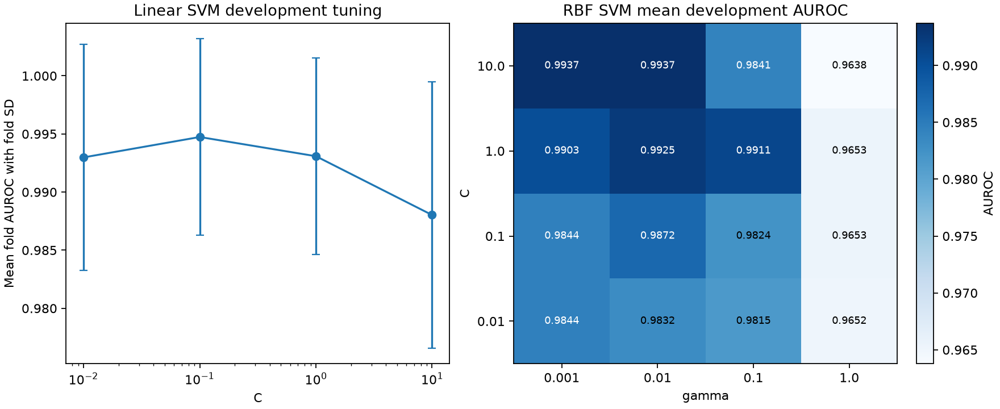
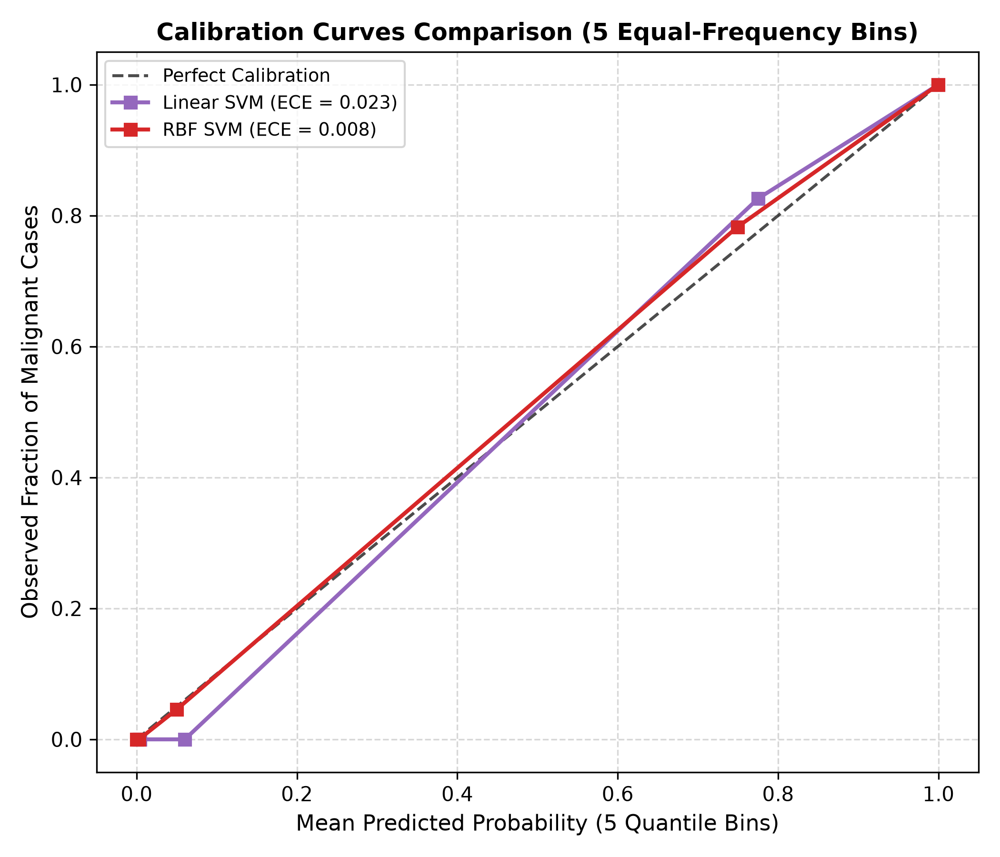
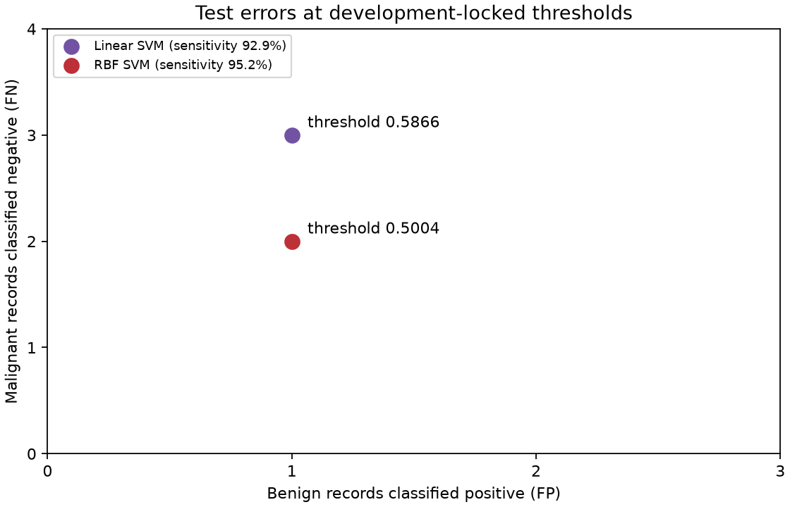

# Asher Xu SVM Methods Results and Interpretation

## Scope and status

Both assigned SVM variants are complete locally. This report uses the frozen shared split (455 development records and 114 test records). Results are educational and do not establish clinical utility. Only the constant baseline and these two SVMs are currently available in this working copy; the other teammates' models have not been evaluated here.

## Methods

All 30 original numeric predictors were retained; ID, diagnosis, target, and split/fold fields were excluded from model inputs. Data contain no missing predictor values, so no imputation was needed. All models used the shared saved five-fold development assignments and random seed 707.

Linear SVM used C in {0.01, 0.1, 1, 10}; RBF SVM crossed those C values with gamma in {0.001, 0.01, 0.1, 1}. Candidate selection maximized mean fold AUROC, with deterministic first-grid-entry tie breaking within tolerance 1e-12. This is 4 and 16 configurations, respectively. C controls the penalty for margin violations; gamma controls the locality of the RBF similarity.

Each fit wrapped Pipeline(StandardScaler, SVC) in CalibratedClassifierCV(method="sigmoid", cv=three-fold stratified CV, ensemble=False). The scaler was inside the wrapped estimator, so internal calibration predictions also used training-only standardization. Calibration learned a sigmoid from internal out-of-fold decision scores; the base pipeline was then fitted on all data supplied to that fit. No SVC internal probability=True routine was used. The official calibration documentation is at https://scikit-learn.org/stable/modules/generated/sklearn.calibration.CalibratedClassifierCV.html.

The selected candidate's five validation folds supplied one OOF probability per development record. The highest OOF threshold achieving at least 95% sensitivity was locked. Hyperparameters and thresholds were saved before final refits and before test prediction. Both final models were fitted on the full development set before accessing held-out features and labels. No model or threshold was changed after the held-out results. A threshold of 0.5 is a secondary reference in saved metric JSON files.

**Important distinction:** mean fold AUROC selected hyperparameters; pooled OOF AUROC summarizes the concatenated validation predictions. These are different quantities. Because tuning used the same five folds, the selected OOF results are post-selection development summaries, not an unbiased nested-CV estimate. The held-out set provides the final internal evaluation.

## Locked development decisions

Preferred SVM before test evaluation: **Linear_SVM**.

- Linear_SVM: parameters `{'C': 0.1}`; mean five-fold AUROC 0.994737; locked threshold 0.5865866714.
- RBF_SVM: parameters `{'C': 10, 'gamma': 0.001}`; mean five-fold AUROC 0.993705; locked threshold 0.5004393213.

## Observed performance

| model      | sample          |   N |   AUROC |   AUPRC |   Brier |   log_loss |    ECE |   threshold |   sensitivity |   specificity |    PPV |    NPV |   FN |   FP |   TP |   TN |
|:-----------|:----------------|----:|--------:|--------:|--------:|-----------:|-------:|------------:|--------------:|--------------:|-------:|-------:|-----:|-----:|-----:|-----:|
| Linear_SVM | development OOF | 455 |  0.9937 |  0.9938 |  0.0181 |     0.0775 | 0.0138 |      0.5866 |        0.9529 |        1.0000 | 1.0000 | 0.9727 |    8 |    0 |  162 |  285 |
| Linear_SVM | test            | 114 |  0.9974 |  0.9956 |  0.0216 |     0.0750 | 0.0229 |      0.5866 |        0.9286 |        0.9861 | 0.9750 | 0.9595 |    3 |    1 |   39 |   71 |
| RBF_SVM    | development OOF | 455 |  0.9934 |  0.9931 |  0.0197 |     0.0810 | 0.0119 |      0.5004 |        0.9529 |        0.9965 | 0.9939 | 0.9726 |    8 |    1 |  162 |  284 |
| RBF_SVM    | test            | 114 |  0.9957 |  0.9929 |  0.0259 |     0.0857 | 0.0083 |      0.5004 |        0.9524 |        0.9861 | 0.9756 | 0.9726 |    2 |    1 |   40 |   71 |

## Test uncertainty

| model_name   |   auroc_mean | auroc_95_ci      |   brier_mean | brier_95_ci      |
|:-------------|-------------:|:-----------------|-------------:|:-----------------|
| Linear_SVM   |       0.9974 | [0.9914, 1.0000] |       0.0216 | [0.0094, 0.0375] |
| RBF_SVM      |       0.9957 | [0.9874, 1.0000] |       0.026  | [0.0087, 0.0483] |

Intervals use the team evaluator's 2,000 paired class-stratified resamples of the same 114 test records. They condition on fitted models and this split, omit retraining and tuning variability, and are exploratory rather than equivalence/noninferiority tests.

### Paired comparison between the SVM variants

| model_name   | comparator   |   auroc_difference | auroc_difference_95_ci   |   brier_difference | brier_difference_95_ci   |
|:-------------|:-------------|-------------------:|:-------------------------|-------------------:|:-------------------------|
| Linear_SVM   | RBF_SVM      |             0.0017 | [-0.0000, 0.0060]        |            -0.0043 | [-0.0145, 0.0028]        |

Differences are model minus comparator. Positive AUROC and negative Brier differences favor the model column. An interval spanning zero does not establish a clear performance difference. A higher point estimate alone is not sufficient to claim superiority.

## Application and interpretation

For Linear_SVM, the locked threshold produced 3 false negatives out of 42 malignant records and 1 false positives out of 72 benign records. Sensitivity was 0.929 and specificity 0.986. These describe classifications of already sampled masses, not measured downstream patient outcomes or numbers of biopsies.

For RBF_SVM, the locked threshold produced 2 false negatives out of 42 malignant records and 1 false positives out of 72 benign records. Sensitivity was 0.952 and specificity 0.986. These describe classifications of already sampled masses, not measured downstream patient outcomes or numbers of biopsies.

On this held-out split, linear SVM had a slightly higher AUROC (0.9974 versus 0.9957), lower Brier score (0.0216 versus 0.0259), and lower log loss (0.0750 versus 0.0857). However, RBF SVM had a smaller five-bin ECE (0.0083 versus 0.0229) and one fewer false negative at its own locked threshold. Probability scoring rules and binned calibration summaries measure different aspects; these rankings need not agree. The paired AUROC difference was about 0.0017 and its interval reached zero; the Brier difference interval also included zero. This analysis does not establish that either SVM is uniformly superior.

**The linear model did not meet 95% sensitivity on the test set:** its 39/42 sensitivity was 92.9%, while RBF achieved 40/42 (95.2%). Both produced 1/72 false positives (specificity 98.6%). The lower secondary threshold of 0.5 is reported as prespecified context only; it was not substituted for the locked threshold after seeing test results.

The 95% development sensitivity target is exploratory and does not guarantee 95% sensitivity in the test set. Interpret probability quality using Brier score, log loss and calibration alongside AUROC. The constant baseline illustrates that high sensitivity alone can be obtained by labeling everyone positive, at the cost of zero specificity.

Development-only permutation importance was computed on each selected model's validation fold (10 permutations per feature). Its averaged AUROC decreases and between-fold SD are saved separately. Related nuclear size and shape measurements are correlated, so individual importance rankings can be diluted or unstable. These are post-selection descriptive explanations and were not used for feature selection.

The final linear SVM coefficient table describes the standardized decision margin, not log-odds ratios or causal effects. RBF predictions do not have one global linear coefficient per original feature. Calibration makes probabilities available but does not establish reliability in new clinical populations.

Both models ranked texture_worst highest by mean validation permutation AUROC decrease. The next-ranked linear features were area_se and radius_worst; the RBF model emphasized radius_worst and compactness_se. Their fold variation and correlated alternatives limit interpretation of these specific rankings.

### Selected figures







## Runtime and environment

| model      |   search_seconds |   final_fit_seconds |   test_predict_seconds |
|:-----------|-----------------:|--------------------:|-----------------------:|
| Linear_SVM |            1.205 |               0.232 |                  0.007 |
| RBF_SVM    |            6.458 |               0.050 |                  0.006 |

Search time includes calibrated five-fold candidate fitting/prediction. Development total time additionally includes validation permutation interpretation. Timings depend on hardware and load.

```json
{
  "python": "3.12.14",
  "platform": "Windows-11-10.0.26200-SP0",
  "packages": {
    "numpy": "2.5.3",
    "pandas": "3.0.6",
    "scikit-learn": "1.9.1",
    "scipy": "1.18.1",
    "matplotlib": "3.11.2",
    "joblib": "1.6.0",
    "tabulate": "0.10.0"
  }
}
```

The existing course environment was used without modifying it. Its pandas version differs from the shared requirements pin; exact executed versions are recorded above and in development_lock.json. This difference is disclosed rather than treated as a matching install. requirements-svm.txt records the executed dependency versions.

## Limitations and next steps

The dataset is small and historical, with only 42 malignant test records. There is no hospital or temporal external validation, patient independence cannot be fully verified from record IDs, and demographic fairness cannot be evaluated. Avoid causal and clinical deployment claims. Test uncertainty and post-selection OOF optimism limit conclusions. The team should add the other prespecified models using the same saved split and evaluation contract, without using these test results to change modeling choices.

## Provenance and delivery

Development lock created: 2026-11-03T02:49:19.633625+00:00. Test stage completed: 2026-11-03T02:50:39.423021+00:00.

The four CSVs in results/predictions follow TEAM_WORKFLOW.md. Input hashes, code hashes, OOF hashes, test-output hashes, runtime, package versions and verification results are in results/svm. Saved fitted model objects are local under models/svm and are not required for the team prediction ingestion. No commit or push has been performed for this analysis.
