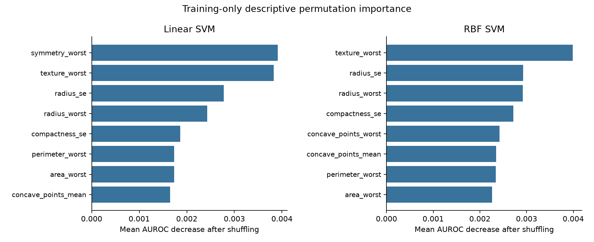

# Linear and RBF SVM analysis

Asher Xu · BIOSTAT 707 final project

## Methods

We compared linear and radial-basis-function SVMs on all 569 WDBC records, including 212 malignant records. Malignancy was the positive class; all 30 predictors were retained and record ID was excluded. StandardScaler was inside the SVC pipeline wrapped by three-fold sigmoid calibration, so calibration, preprocessing and model fitting used training data only. No imputation, oversampling or class weighting was used.

Both models used the team's identical ten repeats of five-fold stratified outer CV, with five-fold inner tuning. Linear SVM searched four C values (0.01, 0.1, 1, 10). RBF SVM crossed these values with gamma values 0.001, 0.01, 0.1 and 1. Settings maximized mean inner-fold AUROC. The original SVM-specific inner seeds and calibration seeds were retained to reproduce the archived run exactly. A training-only inner-OOF threshold targeting at least 95% sensitivity was applied unchanged to outer validation. Five outer folds were pooled before calculating each repeat's primary metrics. The ten repeats reuse records and are not independent studies.

## Results

AUROC includes sample SD across repeats; other metrics are repeat means. AUPRC is summarized as average precision.

| Model | AUROC | Average precision | Brier score | Log loss |
| --- | --- | --- | --- | --- |
| Linear SVM | 0.9930 ± 0.0011 | 0.9918 | 0.0225 | 0.0881 |
| RBF SVM | 0.9943 ± 0.0009 | 0.9935 | 0.0205 | 0.0780 |

The paired RBF-minus-linear AUROC difference averaged +0.001321, with a range from -0.000489 to +0.003766. This is descriptive split variability, not a confidence interval. Against the team's stable ridge logistic comparator, the archived RBF mean AUROC advantage was only +0.000725, ranging from -0.000264 to +0.001414. RBF did not consistently outperform ridge in every repeat. We therefore do not claim a substantial or statistically established benefit from nonlinear complexity.

| Model | Sensitivity | Specificity | PPV | NPV | FN | FP |
| --- | --- | --- | --- | --- | --- | --- |
| Linear SVM | 94.95% | 98.71% | 97.77% | 97.06% | 10.7 | 4.6 |
| RBF SVM | 94.48% | 98.94% | 98.14% | 96.80% | 11.7 | 3.8 |

FN and FP are mean counts among 569 predictions per repeat. RBF's higher AUROC did not produce fewer false negatives: it averaged one additional missed malignant record per repeat relative to the linear SVM. These errors arose at training-selected thresholds, not exactly matched achieved validation sensitivities. Both models fell below 95% validation sensitivity in six of ten repeats. A training sensitivity target is not a guarantee in new data.

## Training-only interpretation

We added a descriptive permutation analysis using only outer-training data from repeat 1. Within each of its five outer-training sets, a five-fold inner split supplied one held-out subset for interpretation; a model was fitted on the remaining inner-training records, and each feature was shuffled ten times. Outer-validation labels were excluded. Hyperparameters had already been selected using the complete outer-training set, so these importance estimates are descriptive after selection and should not be presented as independent validation. They were never used to remove features or revise model settings.

The leading mean AUROC-drop features were symmetry_worst, texture_worst, radius_se, radius_worst, compactness_se for linear SVM and texture_worst, radius_se, radius_worst, compactness_se, concave_points_worst for RBF SVM. Worst texture, radius SE and worst radius appeared in both lists. The linear symmetry ranking varied substantially across folds, illustrating why one ranking should not be treated as a stable biological ordering. Correlated predictors may substitute for one another, producing small or negative permutation effects. The values are not causal effects.

Standardized linear SVM margin coefficients were also refitted for all 50 outer-training sets and summarized by median, interquartile range and sign counts. They describe the SVM decision margin, not log odds, odds ratios or coefficients of the calibrated probability. RBF SVM has no equivalent linear coefficient vector in the original feature space.

## Reproduction and verification

The restored implementation trained both kernels from an empty output directory without reading archived model predictions during training. It produced 11,380 outer predictions, 100 outer-fit records and 1,000 inner candidate records. Every reproduced probability and training-selected threshold matched its archived counterpart exactly at exported precision: maximum absolute difference 0.0 for each kernel. Matching keys included model, repeat, fold, ID and true label. This verifies the historical numerical SVM results in the recorded environment; it does not validate clinical utility.

Four new tests check shared-entry dispatch, preprocessing isolation from external validation records, archive overwrite protection, and rejection of incorrect labels or folds. They passed. Shared regression tests were also checked; a pre-existing Windows line-ending issue in hash-verified forest snapshots required restoring the original LF bytes. A targeted attributes file preserves LF for these snapshots and the exact recorded bytes of the new SVM implementation.

The fitting environment used Python 3.12.14, NumPy 2.5.3, pandas 3.0.6, scikit-learn 1.9.1 and SciPy 1.18.1. The repository's pandas 3.1.0 pin was not installed for this rerun and is not claimed as tested. New manifests record actual library versions, source/data hashes and seeds.

Recorded execution times were Linear SVM: 20.7 seconds total and 0.41 seconds median per outer fit, including tuning and calibration; RBF SVM: 101.1 seconds total and 2.03 seconds median per outer fit, including tuning and calibration. These are environment-specific elapsed times, not a controlled runtime comparison against other team members. Primary archived results were preserved.

## Application and limitations

These classifiers could only hypothetically assist prioritization after fine-needle aspiration and image feature extraction. They do not predict future cancer onset and have not been evaluated for population screening. A false negative could delay review, while a false positive could trigger unnecessary review; actual downstream effects were not measured. RBF's small discrimination advantage must be weighed against probability calibration, threshold behavior and reduced interpretability.

The dataset is small and historical; unique IDs do not independently establish unique patients. Repeated CV is not external validation, and probability calibration can change in another population. No clinical utility, equivalence or noninferiority is established. The interpretation supplement is descriptive and restricted by correlated features and parameter selection. External validation and clinically justified thresholds would be needed before deployment.

## Source files

- src/asher/svm.py and scripts/asher/run.py: restored training and archive comparison.
- scripts/asher/supplement.py: training-only permutation analysis and margin coefficients.
- results/asher/svm_reproduction/archive_reproduction_check.csv: exact numerical comparison.
- results/asher/svm_reproduction/model_summary.csv and repeat_metrics.csv: pooled-repeat evaluation.
- docs/ASHER_SVM_REPRODUCIBILITY.md: commands, seeds, environment and limitations.

Data attribution: Wolberg, W., Mangasarian, O., Street, N., and Street, W. (1993). Breast Cancer Wisconsin (Diagnostic). UCI Machine Learning Repository. https://doi.org/10.24432/C5DW2B. CC BY 4.0, https://creativecommons.org/licenses/by/4.0/. Derived outputs include coded labels, standardized features, CV predictions, evaluation and interpretation summaries.
