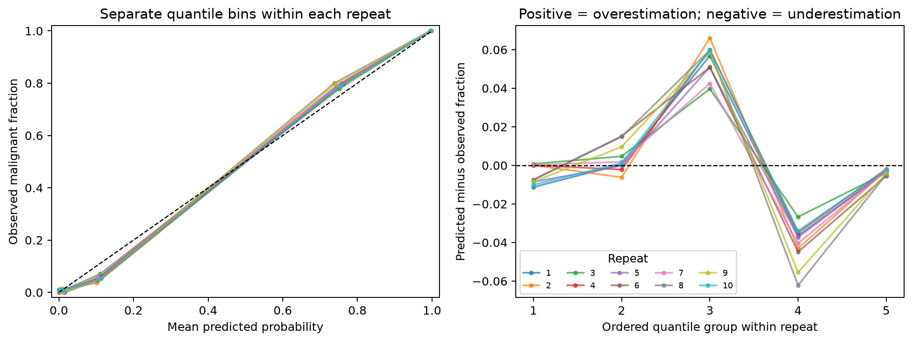
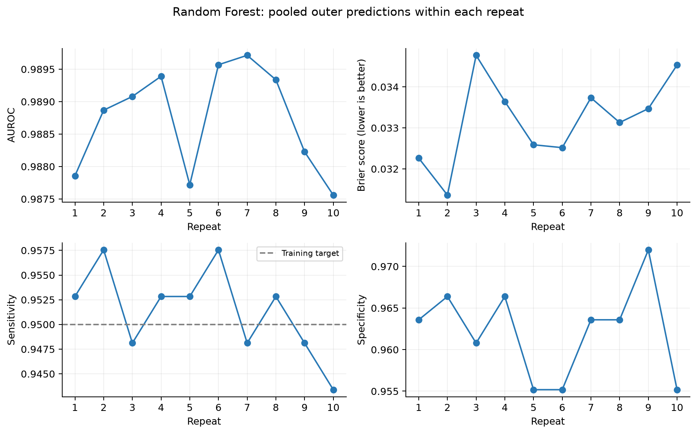
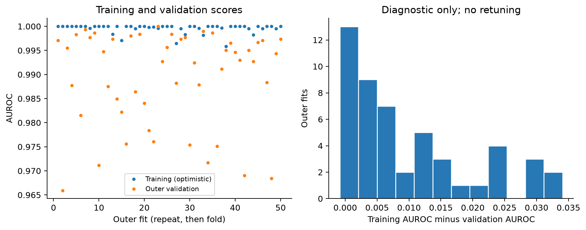
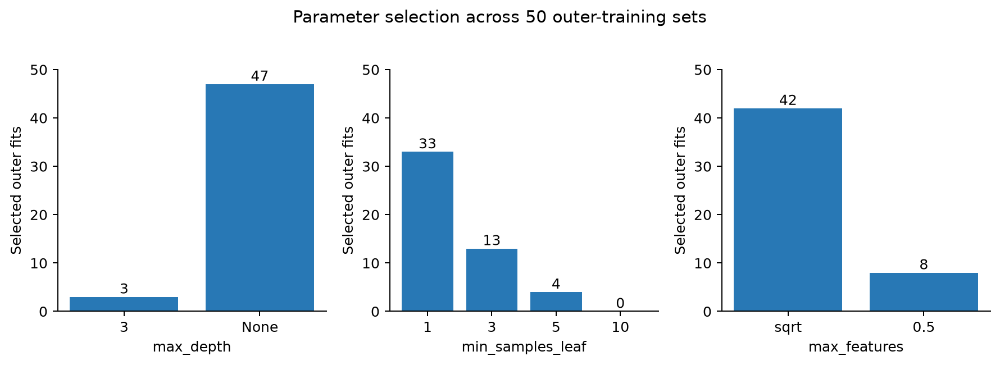
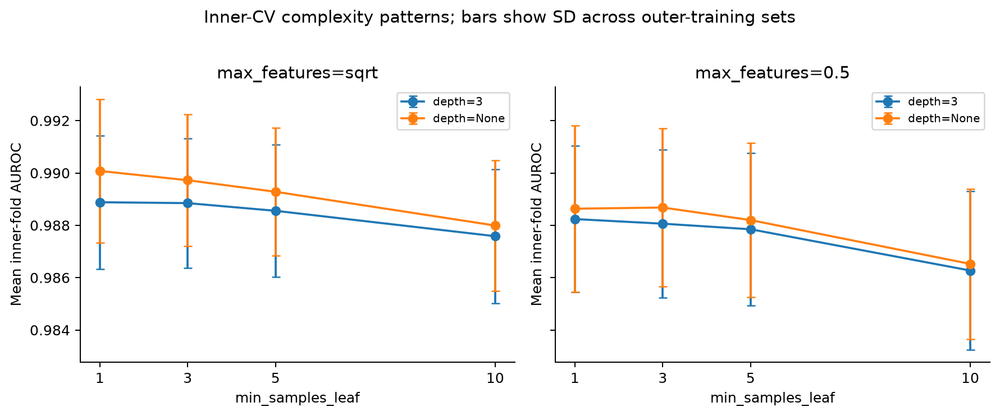
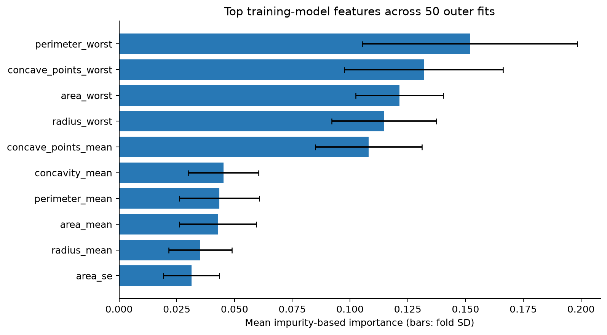

# Random Forest analysis — Yan Yan

## 1. Methods

We fitted Random Forest models to all 569 WDBC records, including 212 malignant and 357
benign records. Malignancy was coded as 1. All 30 nuclear-image features were retained on
their original scale; record ID and outcome fields were excluded from the predictors.
No records were removed, and no imputation, oversampling, class reweighting, feature
selection or extra probability calibration was used.

The analysis followed ten repeats of stratified five-fold outer cross-validation, using
the shared outer assignments. In every outer-training set, stratified five-fold inner CV
selected the largest mean AUROC among 16 settings: max_depth in {3, None},
min_samples_leaf in {1, 3, 5, 10}, and max_features in {sqrt, 0.5}. Each forest had
500 trees. We selected the highest threshold giving at least 95% sensitivity in the
selected setting's training-only inner OOF probabilities. The selected model was refitted
on the complete outer-training set, and the threshold was applied unchanged to outer
validation. Inner OOF results had also been used for setting selection and were not treated
as independent generalization estimates. [S1]

Each repeat pooled its five validation folds before calculating metrics. AUPRC denotes
average precision. AUROC is reported as mean ± sample SD across repeats; other primary
values are repeat means. The repeats reuse the same records and are not ten independent
studies. The 5,690 predictions therefore do not represent 5,690 independent cases. [S2]

## 2. Primary results

| Metric                     | RF repeat summary   |
|:---------------------------|:--------------------|
| AUROC                      | 0.9887 ± 0.0008     |
| AUPRC (average precision)  | 0.9867              |
| Brier score                | 0.0332              |
| Log loss                   | 0.1400              |
| Sensitivity                | 95.14%              |
| Specificity                | 96.22%              |
| PPV                        | 93.73%              |
| NPV                        | 97.09%              |
| False negatives per repeat | 10.3                |
| False positives per repeat | 13.5                |

FN and FP are counts among 569 validation predictions in each repeat; their repeat means
can be fractional. The observed malignant fraction was 37.26%.
Full mean, SD, minimum and maximum values are provided in the supplementary table. [S2]

Using compatible owner-provided nested predictions, the mean paired RF-minus-linear-SVM and RF-minus-RBF-SVM AUROC differences were -0.004276 and -0.005597. The corresponding Brier differences were +0.010685 and +0.012748; RF also had higher mean log loss. These are descriptive paired differences across repeats, not independent study estimates. The planned regression comparison remains pending owner-attributed compatible prediction outputs. [S7]

## 3. Calibration and threshold tradeoffs

Mean predicted malignancy was 37.43%, close to the observed
37.26%. This aggregate agreement did not imply good calibration
throughout the probability range. In the third quantile group, mean probabilities ranged
from 10.2% to 11.3%, while observed fractions
ranged from 3.6% to 7.1%; all ten repeats
showed overestimation. The fourth group showed underestimation in all repeats: mean
probabilities were 73.8%–76.3%, versus
observed fractions of 77.9%–80.0%.
The highest group also showed slight underestimation, with mean predictions of
99.5%–99.8% and an observed fraction of 100%.
The lowest two groups had less consistent bias directions. These are within-repeat
quantile groups, not fixed probability intervals. Approximately five equal-frequency
groups are coarse, and tied probabilities affected boundaries and group sizes. [S3]

Brier score and log loss assess probability quality, including more than pure calibration
error. A probability of zero was assigned to a malignant validation record in
3 repeats; it must not be interpreted as proof that malignancy is impossible.
Log loss used a temporary probability copy clipped to [1e-15, 1-1e-15], leaving the
exported probabilities unchanged. [S3]

The 50 training-selected thresholds ranged from 0.3467 to 0.5260.
Pooled validation sensitivity ranged from 94.34% to
95.75% and fell below 95% in 4 of ten repeats.
The target was a training criterion, not a validation guarantee. FN denotes malignant
records classified negative; FP denotes benign records classified malignant. A false
negative could hypothetically delay review and a false positive could trigger additional
review. Downstream clinical consequences were not measured. [S2, S3]

Linear SVM and RBF SVM averaged 10.7 and 11.7 false negatives, and 4.6 and 3.8 false positives. Their achieved sensitivities were 94.95% and 94.48%, compared with 95.14% for RF. Thus, RF's slightly fewer false negatives came with more false positives and a higher achieved sensitivity. The models shared a training target, not a strictly matched validation sensitivity. [S7]

## 4. Parameter selection and overfitting diagnostics

The most frequent setting was max_depth=None, min_samples_leaf=1 and max_features=sqrt,
selected in 26 of 50 fits. Unrestricted depth was selected
47 times, sqrt 42 times, and leaf sizes 1, 3, 5 and 10 were selected 33, 13, 4 and 0 times.
7 settings were selected overall: the broad preference was consistent, while the exact
configuration was not fixed across splits. Holding max_features=sqrt and depth unrestricted,
the mean paired inner-AUROC difference for leaf size 1 minus 10 was +0.002084.
Holding max_features=sqrt and leaf size 1, unrestricted depth minus depth 3 averaged
+0.001195. Candidate-specific random seeds also differed. These conditional grid patterns
do not establish causal parameter effects. [S4]

Mean training resubstitution AUROC was 0.9996, compared
with a mean outer-fold AUROC of 0.9895; the mean within-fit gap
was 0.0100. Training performance is optimistic because those
records were used in fitting. This fold-averaged diagnostic is a different summary from
the primary pooled-repeat AUROC. It was not used to revise the model. The complete
analysis took 14.25 minutes of recorded wall time, with up to two outer tasks
in parallel and one thread per forest; runtime depends on the computing environment. [S5]

## 5. Feature importance

The leading features were perimeter_worst, concave_points_worst, area_worst, radius_worst, concave_points_mean.
These same five features occupied the top five in every outer-training model, but their
relative order and weights changed. For example, perimeter_worst had mean importance
0.1519 with fold SD 0.0466, and ranked between
1 and 4. These features represent size and contour
irregularity information. Impurity-based importance can favor variables with more split
opportunities, and correlated radius, perimeter, area and mean/worst summaries can share
or substitute importance. The values do not give effect directions, independent
contributions, causal effects or evidence for a specific interaction. No feature was
removed or selected using this analysis. [S6]

## 6. Interpretation and limitations

RF discriminated malignant from benign records well, but its local calibration patterns
and threshold errors remain relevant to any proposed review-prioritization use.
RF did not show a numerical advantage over the two SVMs in discrimination or probability quality in this analysis. Its threshold tradeoff should be considered alongside the different achieved sensitivities. The primary comparison with a stable full-feature logistic model is still pending; no regression conclusion is drawn.

The dataset is small, historical and contains correlated predictors. Unique record IDs
do not independently establish unique patients. Repeated CV describes sensitivity to
splitting the available records; it does not supply new independent patients or external
validation. Five-bin calibration is approximate, and the exploratory 95% sensitivity
target is not a clinically validated operating point. These diagnostic measurements do
not predict future cancer onset in the general population. The analysis establishes
neither deployment readiness nor demonstrated clinical utility. Small differences do
not prove equivalence or noninferiority.

Source notes: S1: fold_results.csv, inner_cv_results.csv, selected_inner_oof.csv and
oof_predictions.csv. S2: report_main_results.csv, repeat_metrics.csv and
report_supplementary_metrics.csv. S3: calibration_points.csv, report_calibration_bins.csv,
report_calibration_pattern.csv and report_probability_extremes.csv. S4: inner_cv_results.csv,
report_parameter_selection.csv, report_parameter_marginals.csv and report_parameter_contrasts.csv.
S5: fold_results.csv and report_runtime.csv (wall time from run_manifest.json sessions).
S6: feature_importances.csv, report_feature_stability.csv and report_feature_families.csv.
S7: owner_comparator_repeat_metrics.csv, owner_paired_repeat_differences.csv and owner_paired_difference_summary.csv, recomputed from the owner-specific nested predictions recorded in comparison_provenance.json. Regression numerical comparison is pending.

## Supplementary RF summaries

These tables describe the same RF run; they are not additional experiments.

### Repeat-level ranges

| metric              |       mean |      std |        min |        max |
|:--------------------|-----------:|---------:|-----------:|-----------:|
| auroc               |   0.988732 | 0.000818 |   0.987560 |   0.989714 |
| auprc               |   0.986745 | 0.000585 |   0.985729 |   0.987751 |
| brier_score         |   0.033201 | 0.001049 |   0.031361 |   0.034770 |
| log_loss            |   0.139982 | 0.024772 |   0.121004 |   0.177733 |
| sensitivity         |   0.951415 | 0.004475 |   0.943396 |   0.957547 |
| specificity         |   0.962185 | 0.005641 |   0.955182 |   0.971989 |
| ppv                 |   0.937340 | 0.008796 |   0.925926 |   0.952607 |
| npv                 |   0.970893 | 0.002619 |   0.966006 |   0.974576 |
| FN                  |  10.300000 | 0.948683 |   9.000000 |  12.000000 |
| FP                  |  13.500000 | 2.013841 |  10.000000 |  16.000000 |
| TP                  | 201.700000 | 0.948683 | 200.000000 | 203.000000 |
| TN                  | 343.500000 | 2.013841 | 341.000000 | 347.000000 |
| mean_predicted      |   0.374307 | 0.001442 |   0.372505 |   0.376726 |
| observed_prevalence |   0.372583 | 0.000000 |   0.372583 |   0.372583 |
| ece                 |   0.022027 | 0.004413 |   0.015167 |   0.029881 |

Source: report_supplementary_metrics.csv, recomputed and checked against the original
repeat_metrics.csv and summary_metrics.csv without modifying those files.

### Feature stability across training models

| feature              |   importance_mean |   importance_sd |   best_rank |   worst_rank |   top5_folds |
|:---------------------|------------------:|----------------:|------------:|-------------:|-------------:|
| perimeter_worst      |            0.1519 |          0.0466 |      1.0000 |       4.0000 |           50 |
| concave_points_worst |            0.1319 |          0.0343 |      1.0000 |       5.0000 |           50 |
| area_worst           |            0.1214 |          0.0189 |      1.0000 |       5.0000 |           50 |
| radius_worst         |            0.1148 |          0.0226 |      1.0000 |       5.0000 |           50 |
| concave_points_mean  |            0.1081 |          0.0230 |      1.0000 |       5.0000 |           50 |

Source: feature_importances.csv and report_feature_stability.csv.
The 50 models use overlapping training data; SD is descriptive split variability.

### Calibration and diagnostics

## Data attribution

Wolberg, W., Mangasarian, O., Street, N., & Street, W. (1993).
Breast Cancer Wisconsin (Diagnostic). UCI Machine Learning Repository.
https://doi.org/10.24432/C5DW2B . CC BY 4.0:
https://creativecommons.org/licenses/by/4.0/ .
Modifications include binary outcome coding, ID sorting, and derived cross-validated
predictions, diagnostics and summaries for this educational study.
